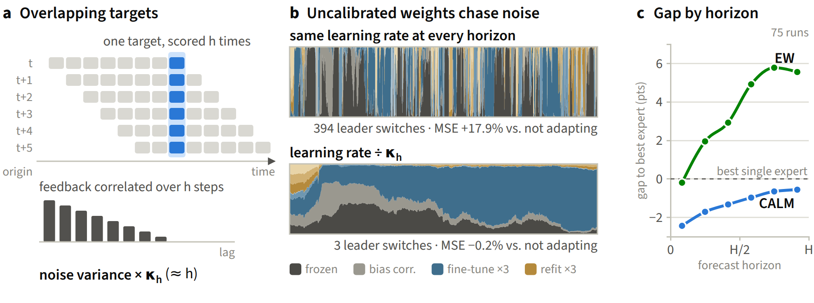
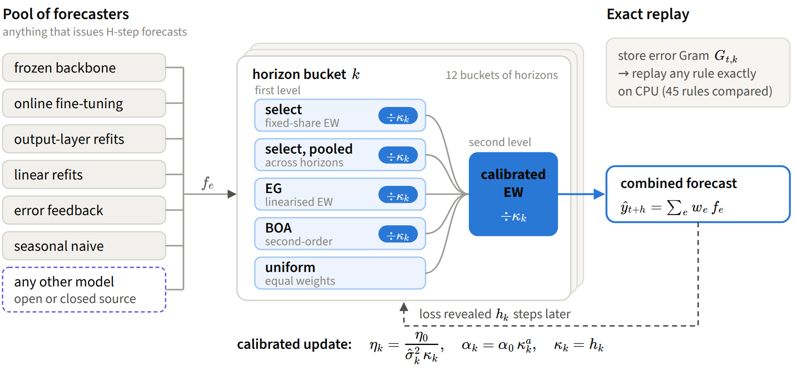
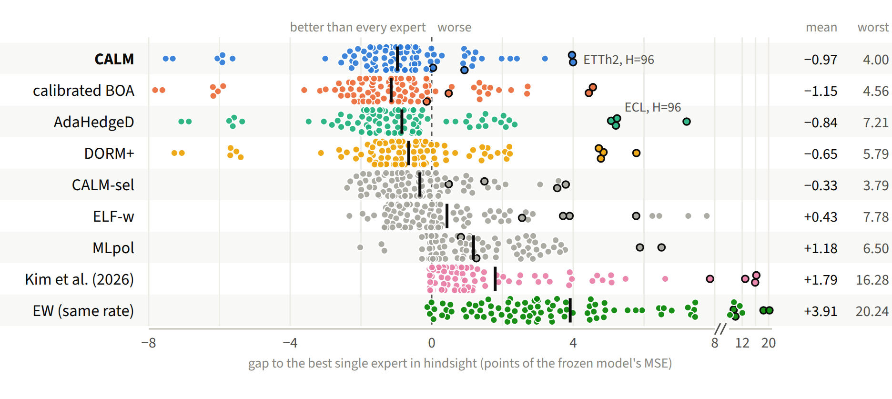
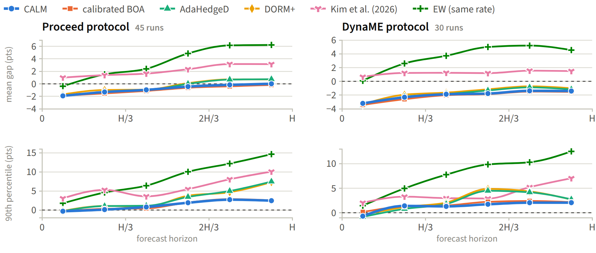

# Stay CALM: Calibrated Online Aggregation for Multi-Horizon Forecasting under Delayed, Overlapping Feedback

Code, per-run results and figures for the paper by **Shivesh Prakash** (University of California, Berkeley).
Paper: *arXiv link coming soon.*



**In one paragraph.** A forecast for $h$ steps ahead is scored $h$ steps later, and forecasts issued at neighbouring
times share most of their targets. The losses that reach an online learner at horizon $h$ are therefore serially
correlated: their long-run variance is inflated by an *overlap factor* $\kappa_h$ that grows roughly like $h$ (up to
$h\approx30$ on most standard benchmarks), and learning rates chosen for independent feedback end up chasing noise (panel b above: hundreds of leader switches, and a
combination that is worse than never adapting). For fixed-share exponential weights the noise-induced excess loss
depends on the learning rate only through $\eta\kappa_h$, so the fix has nothing to tune: **divide every learning rate
by $\kappa_h$** (the theory also lets switching rates grow with it). CALM applies this to calibrated selection, exponentiated
gradient and Bernstein online aggregation, and lets a second calibrated level arbitrate between them. It sits on top of
any pool of forecasters, open or closed source, and its update takes about a millisecond per time step on one CPU
core.



## Use CALM with any forecasting model

CALM never looks inside a model: it only needs each model's forecasts and the values that are observed later. Any
forecaster can therefore be an expert, whether open source (PyTorch, JAX, scikit-learn, statsmodels, a time-series
foundation model), hand-written, or closed source behind an API. The package is pure NumPy.

```bash
pip install git+https://github.com/Shivesh777/CALM.git
```

**Wrap your models as functions** (each gets the history so far and returns the next H values):

```python
from calm import CALMEnsemble

ens = CALMEnsemble({"patchtst": my_torch_model,          # any callable: history [t+1(, C)] -> forecast [H(, C)]
                    "arima": my_statsmodels_fn,
                    "vendor": lambda hist: call_vendor_api(hist, horizon=24)},   # a failed call may return None
                   horizon=24)
for y_t in stream:                     # one observation per step (scalar or C channels)
    y_hat = ens.step(y_t)              # combined forecast of the next 24 values
print(ens.weights_by_model())          # current weight of each model at every horizon
```

**Or feed forecasts you already have**, one step at a time:

```python
from calm import CALM

agg = CALM(n_experts=E, horizon=H)     # 12 horizon buckets; the paper's constants, nothing to tune
for t in range(T):
    # y[t]: value observed at time t, shape [C] (None at the first step)
    # F[t]: the experts' forecasts made at time t for t+1, ..., t+H: array [E, H(, C)], list, or dict name -> array
    w, y_hat = agg.step(y[t], F[t])    # w: [H, E] combination weights, y_hat: [H(, C)] combined forecast
agg.save("calm.pkl")                   # resume later with CALM.load("calm.pkl")
```

**Or backtest on stored forecasts** (e.g. exported from another system), from Python or the command line:

```python
from calm import backtest
res = backtest(forecasts, y)           # forecasts [T, E, H(, C)], y [N(, C)]
res["mse"]                             # CALM vs every model, the equal-weight average and the best model in hindsight
```

```bash
calm backtest --forecasts forecasts.npy --actuals y.npy --names arima,patchtst,vendor --out calm_results.npz
```

`step` first uses $y_t$ to score every forecast whose target has just been observed, then issues the weights for the
forecasts made at $t$, so only matured feedback is ever used. A model that returns `None` or NaN at some step is
replaced by the mean of the others for that step. `CALM(..., combiners=("select", "select_pooled", "uniform"))` gives
the selection-only variant CALM-sel, and `kappa=` overrides the overlap factor (default $\kappa_k=h_k$). A convex
combination cannot protect against a model whose forecasts can blow up, so guard such models (the paper replaces
forecasts far outside the range of the frozen model's by the frozen forecast).

```bash
python examples/quickstart.py                # toy pool
python examples/any_model.py                 # a library-style model, a rule and a mock closed-source API
python tests/test_api.py                     # API tests
python tests/test_online_matches_replay.py   # online implementation = the paper's replay (max |dw| ~ 1e-15)
```

## What is in this repository

| Path | Contents |
| --- | --- |
| `calm/` | The pip-installable, NumPy-only implementation: `CALM` (online aggregator), `CALMEnsemble` (wrapper for any set of forecasting functions), `backtest` and the `calm` command. Its weights match the replay used for every table in the paper to machine precision (`tests/`). |
| `examples/` | `quickstart.py` and `any_model.py`. |
| `experiments/` | The research code: the online forecasting harness (pools of adaptation strategies around iTransformer, PatchTST and RLinear), the exact replay of the aggregation rules from stored error Gram matrices, the analysis and table scripts, the finance pipeline and the simulations. |
| `experiments/results/` | Per-run results (metrics only) of every run in the paper; all tables are rebuilt from them. |
| `figures/` | The paper's figures as D3/HTML sources, the exported data behind them, and the rendered PDFs/PNGs. |
| `third_party/` | The patch that adds a forecast dump to the public code of the published baselines, and third-party licenses. |

## Results in brief

Gap = test MSE minus that of the best single expert in hindsight, in points of the frozen model's MSE (negative:
better than every expert). Development: 75 settings (five datasets, $H\in\{24,48,96\}$, RLinear and iTransformer pools,
two leak-free protocols). Confirmatory: 90 runs in two rounds, each run registered before it was run. Excess: test MSE
above that of the best of the twelve compared methods in the same run.

| | CALM | calibrated BOA | AdaHedgeD | DORM+ | EW (same rate) |
| --- | ---: | ---: | ---: | ---: | ---: |
| Development: settings worse than not adapting | **0** | **0** | 3 | 3 | 15 |
| Development: worst gap | **+4.0** | +4.4 | +7.7 | +8.2 | +20.7 |
| Confirmatory: mean gap | −0.97 | **−1.15** | −0.84 | −0.65 | +3.91 |
| Confirmatory: worst gap | **+4.00** | +4.56 | +7.21 | +5.79 | +20.24 |
| Confirmatory: runs with the lowest error (of 90) | 3 | **48** | 19 | 4 | 2 |
| Confirmatory: runs among the three lowest (of 90) | 59 | **73** | 63 | 32 | 3 |
| Confirmatory: worst excess over the best method of the run | **3.5%** | 4.2% | 7.5% | 6.0% | 21.2% |

* With Proceed (run in its authors' code) among its experts, CALM has lower error than Proceed in **88 of the 90**
  confirmatory runs, by 6.2% on average (3.8% outside ETTh2; significantly lower in 63, never significantly higher).
* CALM is rarely the single best method but almost never far from it: its worst excess over the best method of a run
  is the smallest of the twelve methods in the paper's main table. Calibrated BOA, one of CALM's own calibrated components, has the best average and
  the most wins; AdaHedgeD is slightly better than CALM in most runs but fails badly at the longest ECL horizon.
  The paper reports all of this in detail (main results in its Table 2).





## Reproducing the paper

**Tables** (CPU, a few minutes; from the per-run results in `experiments/results`):

```bash
bash scripts/build_tables.sh            # writes experiments/tables/*.tex
```

**Figures** (Node.js for D3/KaTeX/fonts, Playwright's Chromium for rendering):

```bash
cd figures
npm install                             # d3, katex, Source Sans 3 (versions pinned in package.json)
pip install playwright && playwright install chromium
python export_data.py                   # optional: re-export the figure data from experiments/results
python render.py                        # writes out/*.pdf and out/*.png
```

**Experiments** (GPU for the deep pools; the RLinear pools run on CPU):

1. *Data.* Put the benchmark CSVs into `experiments/data/` (see `experiments/data/README.md`).
2. *Published baselines.* `bash scripts/get_baselines.sh` fetches the public code of GD and Proceed (the DynaME
   repository at the commit we used) and applies `third_party/dyname_dump_preds.patch`, which only adds a dump of the
   forecasts. The scripts in `experiments/pre/` run them with the released hyper-parameters; they were written for a
   cloud working directory, which `python scripts/localize.py <workdir>` rewrites.
3. *Pools.* From `experiments/`: `python -m tsr.run --jobs jobs/<file>.jsonl --out <dir> --data-root data`. Each run
   writes its metrics and, with `dump_stats`, the per-origin error Gram matrices (about 18 GB for all runs; not
   included here).
4. *Replay and tables.* `python ablate.py "<dir>/stats/*.npz" <out>.json` replays the aggregation rules exactly from
   the Gram matrices; the `paper_tab_*.py` scripts build the tables. `experiments/README.md` describes the pipeline.

## Data

* Benchmarks (ETTh2, ETTm1, Weather, Electricity, Traffic): public, standard versions.
* Crypto: public Binance one-minute bars (`experiments/finance_data/dl_binance.py`).
* CME futures: Databento one-minute bars. These are **licensed and not redistributed**; the download and processing
  scripts are in `experiments/finance_data/` and need your own Databento API key (read from `~/.databento/key`).
  Downloading this data is not free.

## Citation

```bibtex
@misc{prakash2026calm,
  title  = {Stay {CALM}: Calibrated Online Aggregation for Multi-Horizon Forecasting under Delayed, Overlapping Feedback},
  author = {Prakash, Shivesh},
  year   = {2026},
  note   = {arXiv preprint}
}
```

## License

MIT (see `LICENSE`). Third-party code and licenses are listed in `NOTICE.md`.
